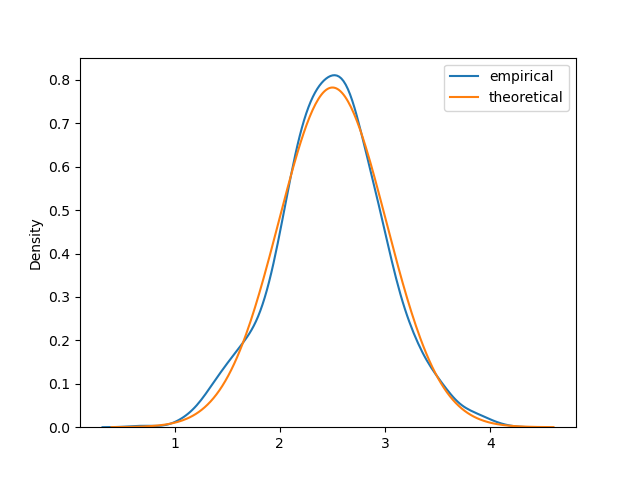

# MPPT: Multi-Particle Parallel Tempering

A JAX library for parallel tempering MCMC with large particle populations.
Bridges between a tractable reference distribution and an unnormalized target via geometric annealing, with automatic MCMC parameter adaptation.

## Features

- Parallel tempering with RW-MH, HMC, or MALA kernels
- Large particle sets at each temperature (tested with 500K+ particles)
- Automatic step size and iteration count adaptation
- Three log-normalizing-constant estimators (SMC-like, robust, reverse logistic)
- SMC sampler with adaptive temperature schedule (beta)
- Index-based swap mechanism for memory efficiency

## Installation

No package manager setup yet. Clone and use directly:

```bash
git clone <repo-url> && cd mppt
```

### Dependencies

Core: `jax`, `jaxlib`, `chex`, `numpy`, `scipy`, `tqdm`

Optional (visualization): `matplotlib`, `seaborn`

Optional (benchmarking): `particles` (Nicolas Chopin's package)

## Quick Start

### Define a problem

A parallel tempering problem requires three components:
- Unnormalized log-density of the target (t=1)
- Normalized log-density of the reference (t=0)
- A sampler from the reference

```python
from jax.scipy.stats import multivariate_normal
from jax import numpy as jnp
from jax import random

def logpdf_final_target(x):
    return multivariate_normal.logpdf(
        x, mean=jnp.array([5, 5]),
        cov=jnp.array([[1, 0.99], [0.99, 1]])
    )

def rvs_ref(key):
    return random.normal(key, shape=(2, ))

def logpdf_ref(x):
    return multivariate_normal.logpdf(x, mean=jnp.array([0, 0]),
                                      cov=jnp.identity(2))

from mppt import PTProblem
problem = PTProblem(rvs_ref=rvs_ref, logpdf_ref=logpdf_ref,
                    logpdf_final_target=logpdf_final_target)
```

### SMC sampler (beta)

```python
from mppt import smc_sampler

key = random.key(0)
all_states, logZ, temperatures = smc_sampler(
    key, problem, n_particles=1000, engine={'name': 'hmc', 'refresh_rate': 0.07},
    n_mcmc_steps=10, local_ess_ratio=0.5, verbose=True, runtime_check=False,
    keep_all_states=True
)
```

At each temperature, HMC runs for 10 iterations with refreshment rate 0.07 (full velocity refresh roughly every 14 steps).
Step sizes and covariance matrices are automatically tuned to keep acceptance rate between 0.8--0.95.

### MCMC engine options

- **HMC**: `engine={'name': 'hmc', 'refresh_rate': 0.07}` -- velocity refreshment rate; targets 0.8--0.95 acceptance
- **MALA**: `engine={'name': 'mala'}` -- HMC with refresh_rate=1, targets 0.5--0.65 acceptance
- **Random walk**: `engine={'name': 'random_walk', 'use_bisection': True}` -- if `True`, tunes step size by bisection (0.2--0.35 acceptance); if `False`, uses the 2.38/sqrt(d) rule

### Parallel tempering from SMC output

```python
from mppt import pt_manual_runners
from tqdm import trange

key = random.key(1)
x = all_states  # SMC output

# Configure and pre-compile
pt_runner = pt_manual_runners(
    problem, temperatures, n_particles=1000, engine={'name': 'hmc', 'refresh_rate': 0.07},
    explorer={'mode': 'adaptive', 'niter': 50},
    swapper={'mix': True}
)
# All JIT compilation happens above; no recompilation from here on.

for _ in trange(20):
    key, subkey = random.split(key)
    x, diags = pt_runner(subkey, x, full_output=False)
    # The previous x is always destroyed (donate_argnums) to save memory.
    # Use full_output=True for complete diagnostics.
    # Save x to disk between iterations to keep intermediate states.
```

The option `swapper={'mix': True}` permutes particles before pairing for swaps, rather than running N independent copies of ordinary PT.

## Interpreting Results

### Log-normalizing constant

```python
print(diags['logZ_SMC_like'])       # importance sampling estimator
print(diags['logZ_robust'])         # symmetric finite-variance estimator
print(diags['logZ_reverse_logistic'])  # Geyer's reverse logistic regression
```

### Swap rejection rates

Array of size K-1 (one per adjacent temperature pair):

```python
diags['swap_rejection_rates']
# Array([0.554, 0.463, 0.395, 0.404, 0.443, 0.454, 0.428, 0.480, 0.230])
```

### MCMC acceptance rates

Array of size K (one per temperature):

```python
diags['mcmc_acc_rates']
# Array([1.0, 0.909, 0.955, 0.950, 0.927, 0.916, 0.923, 0.899, 0.910, 0.916])
```

Temperature 0 is always 1.0 (iid sampling from reference). HMC targets 0.9--0.95; RW and MALA differ.

## Extracting Particles

Particles at the final temperature:

```python
sample = x.X.position[x.Z[-1]]
assert sample.shape == (1000, 2)
```

Quick validation for the correlated normal example: if (X, Y) follows the target, then X - 0.5Y ~ N(2.5, 0.26):

```python
from matplotlib import pyplot as plt
import seaborn as sns
from scipy.stats import norm
import numpy as np

fig, ax = plt.subplots()
sns.kdeplot(sample[:, 0] - 0.5 * sample[:, 1], ax=ax, label='empirical')
xplot = np.linspace(0.4, 4.6, num=300)
yplot = norm.pdf(xplot, loc=2.5, scale=np.sqrt(0.26))
ax.plot(xplot, yplot, label='theoretical')
ax.legend()
fig.show()
```



## Running Tests

Requires Python 3.11+.

```bash
python -m pytest mppt/tests/ -v
```

Some tests are compute-heavy. See `AGENTS.md` for per-module test commands.

## Documentation

- `docs/api.md` -- API reference: engines, explorers, collectors, all parameters
- `docs/architecture.md` -- design decisions and trade-offs
- `docs/extend.md` -- the extend pattern (how MCMC kernels compose with PT)
- `docs/codemap.md` -- module layout, dependency graph, key types
- `AGENTS.md` -- conventions, pitfalls, and agent/contributor instructions
